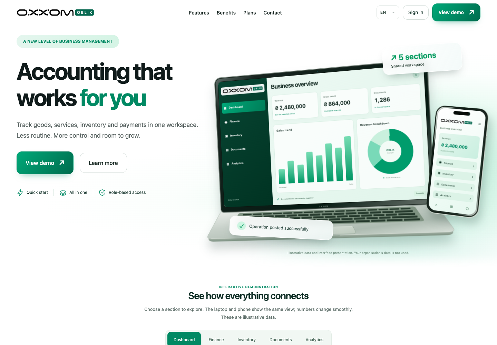
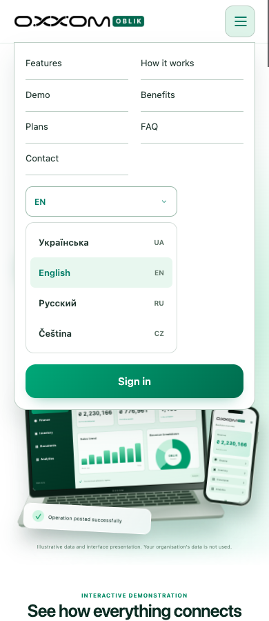

# OXXOM OBLIK

**Товари, склад, документи та оплати — в одному робочому просторі**

OXXOM OBLIK — вебсервіс для оперативного обліку товарів і послуг малого бізнесу.
Він поєднує довідники, продажі, складські операції, внутрішні розрахунки та звіти:
від створення документа до відображення його результату в залишках і русі грошей.

[Відкрити сайт](https://oblik.oxxom.com.ua/) ·
[Увійти в систему](https://oblik.oxxom.com.ua/login/) ·
[Статус проєкту](docs/PROJECT-STATUS.md) ·
[Документація](#документація)



*Англомовна версія публічного лендингу. Показники на екранах ілюстративні;
дані користувачів у зображенні не використовуються.*

## Для щоденної роботи бізнесу

Зберігайте товари, послуги, контрагентів та склади в довідниках. Формуйте
документи з готових позицій, проводьте операції та перевіряйте результат
у залишках, платежах і звітах. Чернетку можна підготувати заздалегідь;
до проведення вона не змінює облікових рухів.

Один користувач може працювати з кількома організаціями. Вибрана організація
зберігається при переходах, а меню та доступні дії залежать від призначеної ролі.

## Можливості

| Розділ | Що реалізовано |
|---|---|
| Довідники | Товари та послуги, одиниці виміру, контрагенти, склади; архівування зі збереженням історії |
| Документи продажу | Багаторядкові реалізації, чернетки, копіювання, проведення та сторно |
| Склад | Надходження, початкові залишки, переміщення, списання та повернення; залишки й журнал рухів |
| Собівартість | Середньозважена собівартість товарів і рух їхньої вартості |
| Оплати | Каси та рахунки, надходження і виплати, прив’язка платежів до документів, аванси та борги |
| Звіти | Продажі, товарні й грошові рухи, залишки, заборгованість та попередній валовий результат; експорт CSV |
| Друк | Рахунки, товарні накладні та акти послуг; збереження PDF через діалог друку браузера |
| CSV-імпорт | Завантаження довідників із перевіркою, попереднім переглядом і явним підтвердженням |
| Команда | П’ять ролей: власник, бухгалтер, менеджер, комірник і спостерігач; історія змін доступу |
| Інтерфейс | Спільна навігація, мобільне меню, українська, англійська, російська та чеська мови |

Товари, послуги, контрагенти та склади в документах обираються з довідників.
Суми, права доступу та проведення перевіряються на сервері. Проведені документи
зберігають знімки реквізитів; виправлення виконуються через передбачені операції.

<details>
<summary>Мобільна навігація та вибір мови</summary>

<p></p>

Публічний лендинг, ілюстративні дані. Мова, вибрана на лендингу, передається
до робочого інтерфейсу.

</details>

## Статус MVP

Сервіс розгорнуто на **Ubuntu** та опубліковано за адресою
**https://oblik.oxxom.com.ua/**. Вхід до робочої організації надає її власник;
публічної самореєстрації немає. На лендингу доступна інтерактивна демонстрація.

Перенесення на Ubuntu, перша зашифрована резервна копія на окремому сервері
та ізольоване тестове відновлення підтверджені власником. SEO-реліз установлено;
підключено Search Console, виконано перевірки доступності мовних сторінок
і надіслано запити на індексування.

Поточна версія призначена для оперативного обліку. Фіскалізація через ПРРО,
банківські інтеграції, M.E.Doc, автоматичний розрахунок ПДВ та повний
регламентований бухгалтерський облік належать до подальшого розвитку.
Комерційні умови й бухгалтерське приймання MVP ще уточнюються.

Актуальні підтвердження та незавершені перевірки — у
[статусі проєкту](docs/PROJECT-STATUS.md).

## Архітектура

Модульний моноліт: Django обслуговує HTML та JSON API, виконує бізнес-правила
й перевіряє доступ до організацій. PostgreSQL зберігає документи та облікові рухи.
У серверній установці Gunicorn працює під systemd, а HTTPS обслуговує окремий
наявний Nginx Manager.

| Компонент | Технології |
|---|---|
| Backend | Python, Django 5.2, JSON API `/api/v1/` |
| Дані | PostgreSQL 16, транзакції та серверні розрахунки Decimal |
| Інтерфейс | Django templates, JavaScript і CSS; серверні мовні версії лендингу |
| Автентифікація | Пароль, TOTP, QR-підключення, одноразові резервні коди |
| Розміщення | Ubuntu 24.04 LTS, Gunicorn, systemd, зовнішній Nginx Manager |

Версії залежностей: [requirements.txt](requirements.txt) та
[requirements-production.txt](requirements-production.txt).

## Безпека та доступ

- Права й належність даних організації перевіряються на backend.
- Доступ до бізнес-даних потребує завершеної двофакторної перевірки.
- TOTP-секрети шифруються окремим ключем; резервні коди зберігаються як хеші.
- MFA-сесія діє до семи днів від входу зі збереженням після закриття браузера.
- Секрети, дампи, робочі дані та приватні пакети перенесення виключені з Git.

Автентифікація та модель прав описані в [AUTH-01](docs/AUTH-01.md),
[ACCESS-01](docs/ACCESS-01.md) і [ACCESS-02](docs/ACCESS-02.md).

## Розробка та запуск

Поточний застосунок розміщено в `backend/`. Для локальної розробки потрібні
Python 3.11+, Docker із Compose та PostgreSQL у виділеному контейнері.
Із кореня репозиторію:

```sh
sh scripts/start-core.sh
```

Сценарій готує локальне середовище, перевіряє конфігурацію, застосовує міграції,
запускає інтеграційні тести в окремій БД та відкриває сервер розробки.
Деталі — [локальна розробка й перевірки](docs/DEVELOPMENT.md).

Поточна Ubuntu-установка використовує розпакований архів релізу. Її
обслуговування й оновлення описані окремо в [DEPLOYMENT](docs/DEPLOYMENT.md).

## Структура репозиторію

| Каталог | Призначення |
|---|---|
| [`backend/`](backend/) | Поточний Django-застосунок, бізнес-модулі, міграції та серверні тести |
| [`tests/`](tests/) | Додаткові Python- і JavaScript-перевірки |
| [`scripts/`](scripts/) | Локальний запуск, перевірки та службові команди |
| [`deploy/`](deploy/) | Серверні профілі та сценарії розгортання |
| [`docs/`](docs/) | Вимоги, архітектура, етапи реалізації та протоколи перевірок |

Ранні `server.py`, `app/` і `OXXOM-Oblik-Prototype.html` збережені як історія
прототипу. Поточний серверний застосунок використовує Django та PostgreSQL.

## Подальший розвиток

- Автоматизувати бекапи, зберігання копій та повідомлення про збої; перевірити запуск після перезавантаження.
- Завершити бухгалтерське й навантажувальне приймання MVP.
- Виміряти швидкодію, розвивати пошукові посадкові сторінки та аналізувати індексування.
- Підготувати документований зовнішній API та розвивати інтеграції з іншими системами.

## Документація

| Тема | Документи |
|---|---|
| Актуальний стан | [PROJECT-STATUS](docs/PROJECT-STATUS.md) |
| Робота з кодом | [DEVELOPMENT](docs/DEVELOPMENT.md) |
| Ubuntu та обслуговування | [DEPLOYMENT](docs/DEPLOYMENT.md) |
| Продуктові вимоги | [Технічне завдання](docs/TZ-v1.md) |
| Довідники та документи | [REF-01](docs/REF-01.md), [DOC-01](docs/DOC-01.md) |
| Склад і проведення | [STOCK-DRAFT-01](docs/STOCK-DRAFT-01.md), [POST-01](docs/POST-01.md), [STOCK-OPS-01](docs/STOCK-OPS-01.md) |
| Оплати та звіти | [MONEY-01](docs/MONEY-01.md), [REPORT-01](docs/REPORT-01.md) |
| Друк та імпорт | [PRINT-01](docs/PRINT-01.md), [IMPORT-01](docs/IMPORT-01.md) |
| Інтерфейс і мови | [UI-SHELL-01](docs/UI-SHELL-01.md), [UI-LOCALIZATION-01](docs/UI-LOCALIZATION-01.md) |
| Пошукова оптимізація | [SEO-01](docs/SEO-01.md), [реалізація та реліз](docs/SEO-01-DELIVERY.md) |

Документи окремих етапів зберігають стан на момент їх виконання. Поточний стан
і відкриті завдання фіксуються в [PROJECT-STATUS](docs/PROJECT-STATUS.md).
