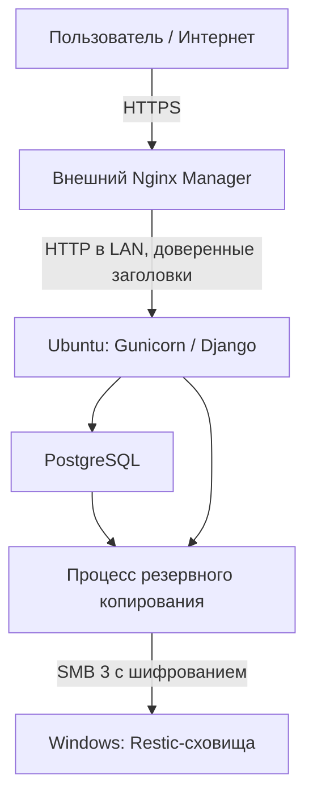

# SECURITY-01 — ТЗ на аудит и усиление безопасности OXXOM OBLIK

Версия 1.1 · 17.11.2026 · ТЗ принято владельцем, выполнение начато.
Первый пакет исправлений: [SECURITY-01A](security/SECURITY-01A-RESULTS.md).
Дополнение владельца: [страницы ошибок](ERROR-PAGES-01.md).
Классификация: внутренняя документация проекта. Пароли, ключи, cookie,
резервные коды, реальные финансовые записи и сетевые адреса инфраструктуры
в документ и Git не включаются.

## 1. Результат работ

Проверить, может ли внешний посетитель, сотрудник с ограниченными правами,
владелец другой организации или нарушитель с доступом к отдельному компоненту:

- получить доступ к чужой организации, её документам, сотрудникам или отчётам;
- обойти MFA, захватить либо сохранить отозванную сессию;
- изменить проведение, платежи или историю без необходимых прав;
- нарушить доступность входа, базы или бизнес-операций;
- извлечь секреты, удалить резервные копии или сорвать восстановление.

Результат — модель угроз, проверяемая матрица требований, технический отчёт,
исправления с регрессионными тестами и повторная проверка. Отсутствие находок
автоматического сканера не является заключением о безопасности системы.

## 2. Основание и границы достоверности

Базовая методика: **OWASP ASVS 5.0.0, целевой уровень L2 для применимых
требований**, OWASP WSTG 4.2, OWASP API Security Top 10 2023 и deployment
checklist Django 5.2. Это цель проверки, а не заявление о достигнутом соответствии.

Перед проверкой сформировать полный реестр применимости требований ASVS L1/L2:
точный ID с версией, применимость, тест, доказательство, статус и ответственный.
Для неприменимого контроля требуется объяснение. Выбор отдельных пунктов
без полного реестра не позволяет объявить соответствие L2. Конфликты с
продуктовыми требованиями фиксируются как отклонения с остаточным риском.

Первичный обзор выполнен по исходникам коммита
[`c1cd440`](https://github.com/oxxom-platform/oxxom-oblik/commit/c1cd440cfaf63ad683cc3a23d402d953ea1f6fd6)
и доступным операционным сценариям рабочей копии. Часть сценариев бэкапа
настроена владельцем непосредственно на VM; наличие файла в рабочей копии
не подтверждает его публикацию или точное совпадение с установленной версией.

Статически найдено 113 объявлений маршрутов `path`, из них 86 начинаются
с `api/`. Это начальный инвентарь исходников, не подтверждение покрытия
фактически доступной внешней поверхности.

Первичный обзор и лабораторная проверка описаны отдельно в
[SECURITY-01-INITIAL-REVIEW](security/SECURITY-01-INITIAL-REVIEW.md).
Полный аудит production, инвентаризация установленных зависимостей и
сертификат соответствия в рамках подготовки этого ТЗ не выполнялись.

## 3. Система и область аудита

Объекты: `https://oblik.oxxom.com.ua`, четыре публичные языковые версии,
вход/MFA/восстановление доступа, кабинет, все бизнес-API, печать и CSV,
Ubuntu VM приложения, PostgreSQL, профиль Gunicorn/systemd, конфигурация
собственного virtual host на существующем Nginx Manager, выделенный ресурс
Windows для резервных копий, GitHub и цепочка выпуска релизов.

Границы доверия: Интернет → прокси; прокси → VM; организация A → организация B;
браузер → серверные бизнес-правила; процесс приложения → ОС/секреты;
VM → резервное хранилище; GitHub/зависимости → устанавливаемый релиз.

За пределами текущего аудита: приложения HUB и других клиентов на общем
прокси, остальные Windows-ресурсы, домашняя инфраструктура, будущие банковские,
ПРРО и M.E.Doc-интеграции. Последние получают отдельную оценку при реализации.
Глобальные изменения общего Nginx или сканирование соседних систем не входят
в эту работу.

## 4. Активы и модель угроз

| Актив | Требуемое свойство | Пример угрозы |
|---|---|---|
| Данные организаций и сотрудников | Конфиденциальность и разделение доступа | Чтение чужих UUID, экспортов или агрегатов |
| Документы, платежи, остатки | Целостность и прослеживаемость | Повторное проведение, подмена цены/статуса, исправление истории |
| Аккаунты, MFA и сессии | Подтверждённая личность и отзыв доступа | Обход второго фактора, replay, захват сессии |
| Ключи Django/TOTP и GitHub-доступ | Ограничение доступа и контролируемая ротация | Утечка конфигурации, истории Git, журналов или токена установки |
| Доступность приложения | Устойчивость к ограниченному злоупотреблению | Общая блокировка входа, дорогой экспорт, переполнение хранилища |
| Данные и ключи восстановления | Восстанавливаемость при компрометации VM | Удаление доступных VM резервных копий |

Проверяются отдельно: анонимный внешний клиент; сотрудник с каждой из пяти
ролей; владелец другой организации; владелец активной/отозванной сессии;
нарушитель с копией БД; нарушитель с правами процесса приложения;
нарушитель с учётной записью записи бэкапов. Владение дампом БД и компрометация
VM с ключами — разные модели, их нельзя объединять одним выводом «всё зашифровано».

## 5. Условия проведения

1. Зафиксировать commit/patch receipts и контрольные суммы кода, реальные
   версии Python/Django/Gunicorn/PostgreSQL/Nginx Manager/Restic, пакетов ОС
   и контейнеров. Составить таблицу различий GitHub и установленного архива.
2. Начать с чтения исходников и конфигурации. Для конфигурации фиксировать
   необходимые флаги, права и владельцев; значения секретов не выгружать.
3. Активные проверки доступа, MFA, конкуренции и лимитов выполнять на
   изолированном стенде с PostgreSQL и синтетическими данными. Нужны две
   организации, все пять ролей и отдельный отозванный доступ.
4. На production выполнить ограниченные проверки внешнего HTTPS, заголовков,
   служебных ответов и эффективной конфигурации. Для этих проб установить
   предел до одного запроса в секунду и общий ограниченный объём.
5. Перебор, блокировку реальных аккаунтов, массовые выгрузки, нагрузочные
   эксперименты и разрушительные проверки восстановления на рабочей БД
   в данный этап не включать. Ограничение production-проб не является
   результатом нагрузочного теста или гарантией защиты от DoS.
6. При повышении 5xx, росте задержек, неожиданном доступе к реальным данным
   или воздействии на соседний сервис остановить активный сценарий,
   сохранить минимальное обезличенное доказательство и уведомить владельца.
7. Все исправления проходят отдельным релизом с проверками и способом отката.
   Резервные копии и смена firewall/SSH не должны лишать владельца доступа.

## 6. Приоритеты и статусы

**P0** — сначала проверить/устранить до расширения внешнего пилота;
**P1** — выполнить в текущем блоке усиления; **P2** — последующее улучшение.
Это порядок работ, а не шкала тяжести найденной уязвимости.

Статусы контроля: `NOT TESTED`, `PASS`, `FAIL`, `BLOCKED`, `N/A`.
Для `PASS` обязательны проверенный релиз и доказательство ожидаемого поведения.
`BLOCKED` и отсутствие доступа не превращаются в `PASS`.

Тяжесть находки определяется отдельно по воспроизводимости, необходимым
правам, охвату организаций и влиянию на данные/доступность. При использовании
CVSS указывать версию и полный вектор; оценки из базы CVE не подменяют
проверку применимости. Не назначать численный балл без достаточных данных.

## 7. Матрица требований

### 7.1. Вход, MFA и сессии

| ID | Приоритет | Требование | Критерий приёмки |
|---|---|---|---|
| SEC-A01 | P0 | Защита от перебора учитывает реальную границу доверия прокси | Ошибки A не блокируют B с другой учётной записью и другим проверенным клиентским адресом; подмена forwarded-заголовка не обходит лимит |
| SEC-A02 | P0 | Пароль без MFA не открывает бизнес-данные | Pending-сессия получает отказ для всех закрытых API, печати и экспортов |
| SEC-A03 | P0 | TOTP и резервные коды устойчивы к replay и гонкам | Неверный/старый/повторный код отвергается; из двух конкурентных предъявлений одного кода успешно только одно |
| SEC-A04 | P0 | Настройка и сброс MFA привязаны к подтверждённой личности | Чужой/истёкший challenge не выдаёт QR/секрет; смена пароля отменяет challenge; ручной сброс имеет процедуру и аудит |
| SEC-A05 | P1 | Парольные и MFA-ответы не дают лишних утечек | Проверены enumeration, необработанные ошибки и журналы; QR формируется локально и доступен только своему enrollment-контексту |
| SEC-A06 | P1 | Хранилище лимитов имеет жизненный цикл | Ограничен рост записей при новых идентификаторах, описаны очистка и блокировки; нет отключения защиты ради устранения общей блокировки |
| SEC-S01 | P0 | Сессия имеет фиксированный максимум семь дней | После 604800 секунд от MFA доступ отзывается; обращения не сдвигают этот предел; закрытие браузера и обычный простой не обрывают сессию |
| SEC-S02 | P0 | Сессии защищены от фиксации и повторного использования после отзыва | ID обновляется при переходах входа, logout/смена пароля/блокировка отменяют доступ; отозванная cookie не восстанавливает полномочия |
| SEC-S03 | P1 | Чувствительные действия требуют свежего подтверждения | Предлагаемый предел свежести — пять минут; подтверждение связано с пользователем, сессией и назначением; права повторно проверяются на действие |
| SEC-S04 | P0 | Транспорт и кэш не раскрывают сессию | Проверены Secure/HttpOnly/SameSite и область cookie, отсутствие общих кэшей для данных, MFA и печати; нет токенов в URL/localStorage |

Семидневная обычная сессия — действующее продуктовое требование владельца.
Его не заменяют автоматическим выходом через 15 минут. Свежая проверка
нужна для изменения прав владельцев, операций восстановления и иных
высокорисковых действий по отдельной матрице. Если выбранный контроль ASVS
требует другого срока, оформить отклонение и остаточный риск: нельзя объявить
такой контроль выполненным только за счёт частичного step-up.

### 7.2. Организации, роли и целостность операций

Минимальный эталон полномочий для тестовых аккаунтов:

| Роль | Разрешённая область | Запрещённые действия для проверки |
|---|---|---|
| Владелец | Управление своей организацией, сотрудниками и бизнес-операциями | Любой доступ к организации без активного членства |
| Бухгалтер | Документы, проведение, оплаты, отчёты, закрытие периода | Управление сотрудниками/владельцами и чужими организациями |
| Менеджер | Чернетки продаж и разрешённые справочники/контрагенты | Проведение, оплаты, финансовые отчёты, изменение прав |
| Комірник | Складские чернетки и разрешённые складские справочники | Продажные цены/финансы, контрагенты, проведение, права |
| Спостерігач | Чтение предоставленных разделов | Создание, изменение, проведение, выдача прав |

Детали полей и действий сверяются с продуктовой моделью и явными разрешениями
`accounts/access.py`. Наличие разрешающего кода само по себе не доказывает,
что разрешение соответствует бизнес-требованию.

| ID | Приоритет | Требование | Критерий приёмки |
|---|---|---|---|
| SEC-Z01 | P0 | Полная изоляция организаций | Подмена org/object UUID в path/query/body не раскрывает записи, суммы, количество, файлы или результаты другой организации |
| SEC-Z02 | P0 | Роли проверяются на backend для каждой операции | Менеджер/комірник/спостерігач не получают проведение, финансы, права или закрытие периода через прямой API-запрос |
| SEC-Z03 | P0 | Выдача полей соответствует роли | В ответах складской роли отсутствуют запрещённые финансовые поля и контрагенты, включая вложенные объекты и CSV |
| SEC-Z04 | P0 | Отзыв членства действует сразу | Новые запросы из открытой сессии/вкладки отклоняются после фиксации отзыва; права из браузера не считаются источником истины |
| SEC-Z05 | P0 | Управление доступом сохраняет границы организации | Владелец A не меняет глобальный аккаунт или роли B; последний владелец защищён при конкурентных изменениях |
| SEC-B01 | P0 | Клиент не задаёт системные поля и итоговые суммы | Игнорируются/отвергаются подставленные role/organization/status/total/actor; деньги пересчитываются сервером без binary float |
| SEC-B02 | P0 | Проведение, сторно и платежи сохраняют инварианты | Повтор/гонка не создают двойных движений или оплат; ошибочный запрос не оставляет частично сохранённых записей |
| SEC-B03 | P0 | История и закрытые периоды защищены | Проведённый документ не переписывается напрямую; контроль версий/периода нельзя обойти датой или прямым запросом |

### 7.3. Web, API, импорт и экспорт

| ID | Приоритет | Требование | Критерий приёмки |
|---|---|---|---|
| SEC-W01 | P0 | Запросы изменения защищены от CSRF | Запрос без действительного токена или с неподходящим Origin не меняет состояние; включая вход, MFA, logout и права |
| SEC-W02 | P0 | Пользовательские поля безопасны во всех контекстах | Названия/примечания не выполняют HTML/JS в списке, деталях, печати, ошибках, JSON bootstrap и DOM; проверены реальные sinks |
| SEC-W03 | P0 | Нет инъекций в SQL/команды/пути | Параметры фильтров, сортировки, CSV и архивов не управляют исполняемым кодом или доступом за разрешёнными путями |
| SEC-W04 | P1 | Политики браузера согласованы с интерфейсом | CSP сначала проверена в Report-Only, затем применима без поломки inline-кода, QR и печати; проверены frame/base/object/form ограничения |
| SEC-W05 | P0 | Обработка файлов ограничена и атомарна | Проверены лимиты CSV 1 MiB/1000 строк, структура/кодировка/длины, чужой batch, повтор подтверждения и отзыв прав между preview/confirm |
| SEC-W06 | P1 | CSV безопасен при открытии в таблицах | Формулы с опасными префиксами и скрывающими пробелами/управляющими символами не исполняются во всех экспортируемых текстовых полях |
| SEC-W07 | P1 | Расход ресурсов ограничен до дорогой обработки | Лимиты тела/времени/пагинации/выгрузки согласованы на прокси и приложении; ошибки не расходуют неограниченные БД/CPU/диск |
| SEC-W08 | P0 | Приватные файлы не доступны как статические | `.env`, Git, ключи, дампы, приватные архивы и служебные отчёты не выдаются по HTTP; allowlist ассетов не обходится путём/кодировкой |
| SEC-W09 | P1 | API-инвентарь соответствует установке | Учтены живые URL/методы/роли, служебные и старые версии; публичные точки отделены от защищённых; будущий SSRF/внешние API имеют явную применимость |

### 7.4. Прокси, сервер, секреты и выпуск

| ID | Приоритет | Требование | Критерий приёмки |
|---|---|---|---|
| SEC-I01 | P0 | Собственный virtual host принимает правильный домен | HTTPS корректен снаружи, чужой Host не попадает в приложение; нет подмены схемы, открытого redirect или влияния на соседние проекты |
| SEC-I02 | P0 | Доверие к forwarded-заголовкам ограничено | Реальный TCP peer сверяется с разрешёнными прокси; клиентские заголовки на границе перезаписываются/разбираются по документированной цепочке |
| SEC-I03 | P0 | Сетевые интерфейсы соответствуют модели | PostgreSQL и backend недоступны произвольным внешним источникам; подтверждены нужные ACL и работоспособность административного доступа |
| SEC-I04 | P1 | TLS и внутренняя граница доверия оценены | Проверены сертификат/цепочка/обновление/TLS; для LAN HTTP описаны сегментация и остаточный риск передачи cookie, вне доверенной зоны используется защищённый канал |
| SEC-I05 | P1 | Эффективные привилегии приложения минимальны | Проверены unit, UID, sandbox, права кода/секретов/журналов и БД; runtime не управляет ОС/ролями БД/другими приложениями |
| SEC-I06 | P0 | Production-конфигурация проверена фактически | DEBUG выключен, hosts/origins заданы явно, нет dev-сервера/старого прототипа наружу; `check --deploy` выполнен с установленной конфигурацией |
| SEC-K01 | P0 | Секреты отделены от источников и доказательств | Проверены рабочая копия, история Git, артефакты, логи и временные пакеты; найденные реальные секреты отозваны/ротированы, а не только удалены из файла |
| SEC-K02 | P1 | Ротация ключей не уничтожает доступ и восстановление | Описан и проверен переход Django/TOTP/backup-ключей, совместимость и отзыв сессий; секреты не пересоздаются вслепую |
| SEC-C01 | P1 | Доступ установки к GitHub ограничен | На VM нет ненужного персонального admin-токена; учтены scope, хранение, отзыв и доступ только к нужному репозиторию |
| SEC-C02 | P0 | Версии зависимостей и релиз воспроизводимы | Инвентарь установленных прямых/транзитивных пакетов, ОС/образов; проверки по актуальным advisory с применимостью; план полного lock/хешей |
| SEC-C03 | P1 | Выпуск защищает текущие данные и источник | Закреплённый commit, проверенные файлы, негативные тесты в CI, выявление утечек и документированный rollback; конфигурация и рабочая БД не заменяются случайным архивом |

### 7.5. Бэкапы, аудит и обнаружение

| ID | Приоритет | Требование | Критерий приёмки |
|---|---|---|---|
| SEC-R01 | P0 | Резервное копирование реально регулярно работает | Заданы 7 ежедневных/4 еженедельных копии, расписание и отсутствие незаметного пропуска; после reboot проверены mount, backup и отчёт о результате |
| SEC-R02 | P0 | Компрометация VM не уничтожает все средства восстановления | Есть независимо защищённая offline/immutable-копия либо проверенная append-only схема; обычные учётные данные VM не удаляют все сохранённые копии |
| SEC-R03 | P0 | Данные и ключи восстанавливаются согласованной парой | Проверены оба репозитория и matching job; retention сохраняет keys для всех оставленных data snapshot-ов и не удаляет хорошие копии после частичного сбоя |
| SEC-R04 | P0 | Восстановление проверено по бизнес-инвариантам | Изолированная БД/VM: миграции, суммы, остатки, MFA, роли и доступ; целевые RPO ≤24 ч/RTO ≤4 ч измерены, а не выведены из одного короткого теста |
| SEC-L01 | P1 | Значимые действия имеют прослеживаемость | Успех/отказ входа/MFA, смена прав, step-up, проведение/сторно, ключевые операции и ошибки бэкапа дают события с временем, actor/result и correlation ID |
| SEC-L02 | P0 | Журналы не содержат секретов | Проверены реальные лог-сообщения и исключения: без паролей, OTP, QR URI, recovery-кодов, session cookie, GitHub/SMTP/SMB/backup-токенов |
| SEC-L03 | P1 | Ошибки безопасности и бэкапа достигают владельца | Проверена доставка на настроенный канал и восстановление после сбоя; отправка без исключения не считается доказательством доставки |

## 8. Обязательные сценарии повторной проверки

| Тест | Сценарий | Ожидаемый результат |
|---|---|---|
| T01 | Анонимная и password-only сессии вызывают защищённые точки | Нет бизнес-данных; корректный отказ/переход на вход; приватный ответ не кэшируется |
| T02 | Клиент A ошибается во входе; B за тем же прокси вводит верные данные | B сохраняет возможность входа при отдельном проверенном клиентском адресе; общий аварийный лимит не заменяет персональный |
| T03 | Клиент подделывает `X-Forwarded-*`/`X-Real-IP`, включая список адресов | Не меняет доверенную схему/адрес для обхода лимитов или кражи сессии |
| T04 | Повтор и конкурентное предъявление TOTP/backup-кода | Одноразовость; никаких частично выданных сессий/кодов |
| T05 | Смена пароля, блокировка и повторное включение аккаунта | Старые pending/full сессии не восстанавливают доступ |
| T06 | 7 дней, простой, закрытие браузера и посещение лендинга | Сохранена согласованная семантика сессии; абсолютный срок не продлевается |
| T07 | Подмена UUID организации и объекта во всех каналах | Отказ без утечек чужих строк/сумм/счётчиков/печатных форм |
| T08 | Все пять ролей вызывают все действия напрямую | Полное совпадение матрицы backend-прав; включая поля ответов и экспорт |
| T09 | Отзыв роли между просмотром, сохранением, импортом и проведением | Действие повторно авторизуется; нет записи по устаревшему разрешению |
| T10 | Двойное проведение/сторно/платёж и одновременное изменение документа | Сохранены целостность, версия, состояние периода и число движений |
| T11 | Некорректные числа/JSON/CSV/размеры и лишние системные поля | Предсказуемый отказ без 500, изменения итогов и частичных записей |
| T12 | XSS-canary в справочниках/примечаниях и formula-canary в CSV | Данные отображаются как данные во всех контекстах |
| T13 | CSRF без токена/с чужим Origin, неправильный Host и прямой доступ к backend | Нет изменения состояния или обхода trusted-proxy политики |
| T14 | Поиск приватных файлов через HTTP и обходы имён ассетов/архива | Нет выдачи секретов и выхода за разрешённые каталоги |
| T15 | Потеря mount/Windows, неверный ключ, незавершённая пара снимков | Понятный отказ, доставка сигнала, сохранение предыдущих пригодных копий |
| T16 | Восстановление на изолированную БД/VM и попытка удаления копий тестовой учёткой VM | Бизнес-проверки пройдены; независимая защищённая копия сохраняется |

Полная матрица строится по фактическому реестру endpoint-ов, их методам,
ролям и состояниям. По одному «похожему» API нельзя принять весь модуль.
Конкурентные сценарии повторяются на PostgreSQL; SQLite годится для отдельного
воспроизведения логики, но не подтверждает блокировки PostgreSQL.

## 9. Доказательства и отчётность

Каждая находка содержит: ID; затронутый commit/компонент; статус подтверждения;
актор и необходимые права; ожидаемый/фактический результат; минимальное
воспроизведение на синтетических данных; влияние и ограничения; CWE/ASVS/API
ссылки при обоснованной классификации; способ исправления; регрессионный тест;
commit исправления и независимый результат повторной проверки.

Доказательства отделяются от самого ТЗ. Cookie, ключи, парольные поля,
реальные документы и дампы не прикладываются в Git или публичные issues.
Для образцов используются синтетические UUID и зарезервированные тестовые адреса.
Закрытый реестр доказательств имеет владельца, правила доступа и срок хранения.

Обязательные результаты:

1. Инвентарь активов, endpoint-ов, прав, версий и различий установленного релиза.
2. Модель угроз и полный ASVS-реестр применимости/покрытия.
3. Краткий отчёт владельцу: ключевые риски, влияние, порядок исправления.
4. Технический реестр находок, тестов и обезличенных доказательств.
5. PR с исправлениями и негативными регрессионными тестами.
6. Протокол релиза/отката, проверка восстановления и доставки уведомлений.
7. Итог повторного аудита и список явно оставленных рисков с владельцем/сроком.

## 10. Порядок работ и приёмка

| Блок | Содержание | Условие завершения |
|---|---|---|
| SEC-01A | Инвентарь, чтение production-конфигурации, модель угроз, baseline | Есть точный объект проверки, версии и реестр применимости; секреты не раскрыты |
| SEC-01B | Вход/MFA/сессии, trusted proxy, организации/роли, финансовые инварианты | Отрицательные и конкурентные тесты, подтверждённые находки и исправления P0 |
| SEC-01C | Web/файлы, ОС/БД, зависимости, секреты и выпуск | Проверки политики браузера, эффективных прав, SCA и релиза с rollback |
| SEC-01D | Регулярные/защищённые копии, восстановление, события/уведомления, retest | Воспроизводимое восстановление и проверка исправлений на целевом релизе |

Предварительная оценка первичного аудита и повторной проверки — 5–8 рабочих
дней одного инженера при готовом стенде и доступных конфигурациях. Это не срок
устранения всех находок: объём исправлений определяется после SEC-01A/B.

Для принятия блока обязательны:

- все применимые P0 проверены; не осталось подтверждённых Critical/High;
- пройдены изоляция организаций, обход MFA/отзыв сессии и целостность операций;
- проверены защищённость и восстановление резервных копий;
- для остальных применимых пунктов есть доказанный результат либо явно
  зафиксированные ограничения; неизвестное не представлено как пройденное;
- исправления повторно проверены на указанной версии, приложение доступно,
  рабочий сценарий и семидневная сессия сохранены;
- для Medium/Low есть ответственный, срок и описание остаточного риска.

Предлагаемые сроки реакции после подтверждения: Critical — немедленно
локализовать и дать владельцу план в тот же рабочий день; High — исправить
до расширения пилота; Medium — план до 14 дней; Low — до 30 дней.
Это проектные ориентиры для согласования, а не обещание действующего 24/7 SOC.

## 11. Первичные источники

- [OWASP ASVS, стабильная версия 5.0.0](https://asvs.owasp.org/downloads/).
- [OWASP WSTG, версия 4.2](https://owasp.org/www-project-web-security-testing-guide/).
- [OWASP API Security Top 10 2023](https://owasp.org/API-Security/editions/2023/en/0x11-t10/).
- [Django 5.2 deployment checklist](https://docs.djangoproject.com/en/5.2/howto/deployment/checklist/).
- [Django: security system checks](https://docs.djangoproject.com/en/5.2/ref/checks/).
- [Gunicorn: развёртывание и REMOTE_ADDR](https://gunicorn.org/deploy/).
